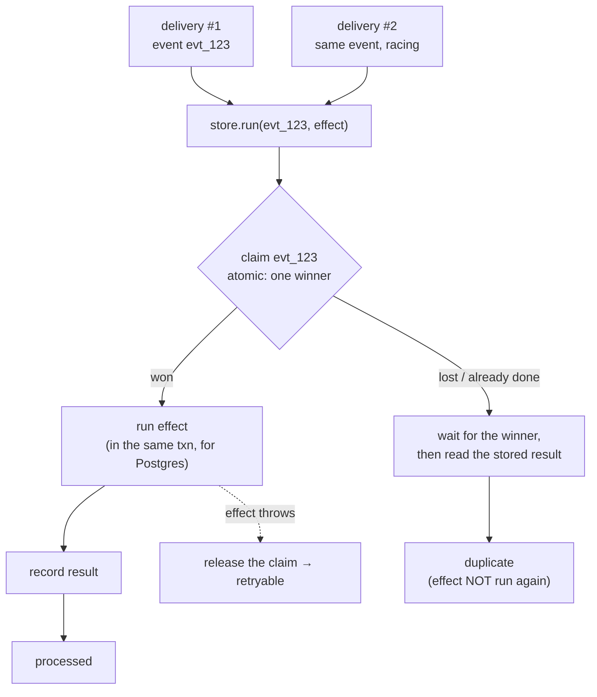

# Design notes

Why this library is shaped the way it is, what it guarantees precisely, and —
just as important — what it does **not** do. If you are evaluating it for real
money moving through a webhook, read the limitations section before the rest.

## The guarantee, stated precisely

> Given an **at-least-once** delivery channel, run a side effect **exactly once**
> per key, and make every later delivery observe the first run's result.

"Exactly once" is about *processing*, not *delivery*. A payment provider will
deliver the same event as many times as it takes to get a `2xx`; that is not a
bug to be fixed, it is the contract of every real webhook. What must happen once
is the *effect* — crediting the account, inserting the ledger row, calling the
downstream API. This library moves the once-ness from the network (impossible) to
the storage layer (a solved problem), keyed by the event's own stable id.

Two distinct failure modes have to be closed, and they are not the same bug:

1. **Sequential duplicates.** The event arrives, is processed, and arrives again a
   second later. A naive `SELECT ... then INSERT` handles this.
2. **Concurrent duplicates.** Two copies arrive in the same millisecond, on two
   servers, and both pass a naive "have I seen this?" check before either writes.
   This is the one that actually loses money, and the one a `SELECT-then-INSERT`
   does **not** close. It needs serialisation, not just a check.

## How each store closes both

### Postgres store — the one for production

The guarantee rests on the database, not on application logic:

- **`INSERT ... ON CONFLICT (key) DO NOTHING RETURNING key`** claims the key.
  Exactly one transaction at a time holds the key; a concurrent one gets zero rows
  unless the holder rolls back.
  That is the atomic election of "who is the first delivery" — the database, not
  the app, decides, and it decides once.
- **The losers wait inside that same `INSERT`.** While the winner's row is
  uncommitted, a concurrent insert of the same key blocks until the winner's
  transaction ends. On the winner's `COMMIT` the loser's insert returns zero rows,
  and the loser reads the committed row (`SELECT ... FOR UPDATE`, which no longer
  has anything to wait for) and returns the stored result. On the winner's
  `ROLLBACK` (its effect threw) the loser's insert succeeds and it becomes the new
  holder (limitation 7).

The decisive property: **the effect runs inside the same transaction as the
idempotency record.** Your `UPDATE accounts ...` and the `status = 'done'` write
commit together or roll back together. There is no interval where the money moved
but the event was not recorded, or the reverse. That is why the effect is handed
the transaction's client as its context — so its writes join the same atom.

### Redis store — across processes, when the effect is idempotent

The claim is a single atomic `SET key value NX PX` — only the first caller sets the
key; everyone else gets "already set" and polls the key until it holds the result.
The claim is written with a short **`pendingTtl`** (default 30s), so a holder that
crashes mid-effect frees the key in seconds rather than for the whole dedup window;
on success the key is rewritten with the full `ttlSeconds`. If the effect throws,
the holder deletes the key so a later delivery retries. Every claim's value carries
a random **ownership token**, and both of those writes are atomic compare-and-set /
compare-and-delete Lua scripts against it: a holder only finalizes or releases a
claim that is still its own. If the *result write* fails
after the effect already succeeded, the holder does **not** delete the key — that
would re-run an effect that ran — it leaves the short-lived claim to expire and
surfaces the error. The completed TTL doubles as the retention policy, so unlike
the Postgres store there is no table to prune.

What it buys over Postgres: no connection held open for the effect's duration, no
retention job, and Redis-speed claims. What it gives up is in the limitations below.

### Memory store — for one process

No database, so the serialisation is a per-key promise. The first caller for a key
installs a `pending` entry holding a promise that only it can resolve. Concurrent
callers find that entry, `await` the promise, and re-check — so they queue behind
the first run instead of racing it. The claim is synchronous up to the first
`await effect()`, which is what makes it safe: no other call can interleave
between "is there an entry?" and "install my entry" because that window contains
no `await`.

It is correct **only within one process**. It shares nothing across replicas and
survives nothing across a restart. Use it for tests, a CLI, or a single
unreplicated server — never as the dedup layer for a horizontally-scaled service.

## Alternatives, and why this design doesn't use them

The design above is easiest to judge against what it could have been. This
section is the reasoning for the current shape, written after the fact. It is
not a history of what was tried and in what order.

- **Check, then insert** (`SELECT` the key; if absent, run the effect and
  `INSERT`). This closes sequential duplicates only. Two concurrent deliveries
  both see "absent" and both run the effect. See "The guarantee, stated
  precisely" above.
- **A plain `INSERT` and catch the unique violation.** The election is just as
  atomic, but in Postgres the failed insert aborts the loser's transaction
  (`current transaction is aborted, commands ignored until end of transaction
  block`) unless it is wrapped in a savepoint, which costs a subtransaction and an
  `ERROR` in the logs on every duplicate. `ON CONFLICT DO NOTHING RETURNING`
  reports "not you" as zero rows with no error. Its insert has already waited for
  the winner to finish, so the loser's next statement reads the winner's committed
  result.
- **An advisory lock** (`pg_advisory_xact_lock(hashtext(key))`). It serialises
  callers, but it is a lock, not a record. You still need a row that says "done"
  and holds the result, so it adds a second mechanism without removing the first.
  And `hashtext` is 32-bit (`hashtextextended` is 64-bit): unrelated keys can,
  rarely, share a lock and wait on each other.
- **`SERIALIZABLE` isolation and retry.** Postgres would abort one of two
  conflicting check-then-insert transactions, which is correct. But every caller
  then needs a retry loop around the whole transaction, including the effect. And
  correctness would depend on an isolation setting a caller can change, rather
  than on the primary key, which they can't.
- **Run the effect, then record the key** (outside one transaction). A crash
  between the two leaves an effect that ran with no record, so the provider's
  redelivery runs it again. Recording first and running after has the opposite
  hole: a crash between them leaves a key marked handled that never ran. Postgres
  avoids both by putting the effect and the record in one transaction. Redis
  can't, which is why it records "pending" first and expires that claim (see
  limitations 3 and 4).
- **Redis with Redlock instead of a single `SET NX`.** Redlock spreads the claim
  over several Redis nodes, but it is still a lease. An effect that outlives the
  lease can still run twice. The ownership token is a compare-and-set check, not a
  fencing token: a late holder can't overwrite or release a claim that isn't its
  own, but nothing outside Redis checks it, so it can't fence the effect. That is
  why the Redis store is for idempotent effects, and why it reports `lostClaim`
  when its lease ran out.
- **The provider's idempotency key.** That protects requests *you* send to the
  provider, such as creating a charge. It does nothing for webhooks the provider
  sends *you*. On this side, the event's own id is the key.

What the library leaves to the caller, deliberately: an effect that calls an
external API can't join the database transaction. The usual pattern is an outbox:
write "call this API" as a row inside the effect's transaction, and have a separate
worker send it with the provider's idempotency key. With the Postgres store, the
library makes the row happen once. The provider's idempotency key makes the
call's effect happen once, within the provider's key-retention window; the call
itself may repeat.

## Handler-failure semantics

If the effect throws, **nothing is persisted for the key** and the error is
re-thrown. The next delivery is treated as the first caller and retries. This is
deliberate: a failed credit should be retried by the provider's next delivery, not
silently marked done.

The important corollary, and a real sharp edge:

- **Postgres:** the effect's partial writes are inside the transaction, so a throw
  rolls *them* back too. Retrying is clean.
- **Memory / Redis / non-transactional effects:** there is no transaction. If your effect
  does external I/O (charges a card, calls an API) and *then* throws, that I/O is
  not rolled back, and the retry repeats it. The library can only guarantee
  once-ness for work that commits atomically with the idempotency record. For the
  memory store, that means in-process state; for anything crossing a process
  boundary, make the effect itself idempotent or use the Postgres store with the
  I/O expressed as a database write.

## Ordering and other non-goals

- **No ordering guarantee across keys.** Different events run concurrently. If
  event B must not be processed before event A, this library is not where that
  ordering belongs.
- **Not a queue, scheduler, or retry engine.** It makes *your* handler safe to
  call more than once; your framework still receives, acks, and (on a thrown
  error) returns non-2xx so the provider retries.
- **Not a signature verifier.** Verify the provider's signature *before* calling
  `run` — pair it with a signature check.

## Known limitations

These are the things a reviewer should know going in. None are hidden.

1. **The Postgres table grows forever without pruning.** Every processed key is a
   row kept for dedup. Run `pruneExpiredKeys(pool, { olderThanSeconds })` on a
   schedule (or the one-line `DELETE ... WHERE completed_at < now() - interval`) to
   drop keys older than your provider's retry window. The library ships the helper
   but not a policy — the window is yours to choose, and pruning too early stops
   deduplicating a still-possible redelivery. (The Redis store needs none of this:
   its TTL expires keys itself.)
2. **The memory store is unbounded unless you pass `maxEntries`.** With it, the
   store only dedups within its window: an evicted key, re-delivered, runs again.
   Size the window above the number of distinct events inside the retry window.
3. **The Redis store is not transactional with your effect.** Postgres runs the
   effect and the "done" record in one transaction, so they commit together or not
   at all. Redis has no such transaction here: the effect runs, *then* the result
   is written. If the process dies in between, the key's short `pendingTtl`
   (default 30s) lapses and the next delivery re-runs the effect — so the Redis
   store is for effects that are themselves idempotent, or where the dedup window
   is the whole requirement. For an effect that must be atomic with a database
   write, use the Postgres store.
4. **A Redis effect that outlives `pendingTtl` can run twice.** If the effect runs
   longer than `pendingTtl`, the claim expires mid-flight and another caller can
   claim the key and run the effect too. The ownership token (0.7.0) limits the
   damage: the late holder's result write and failure-release are
   compare-and-set / compare-and-delete against its own token, so it can no longer
   overwrite the new holder's result or delete its claim (which used to let a
   *third* caller run as well). It cannot undo the second run itself — a lease
   cannot. What it can do is tell you: whenever a holder's claim expired before
   its result write, its call returns `{ status: "processed", lostClaim: true }`.
   That covers both outcomes of an expired claim: another caller took over (the
   effect may have run twice), or nobody did and nothing was recorded (the next
   delivery runs the effect again). Either way the one caller that knows sees it.
   Set `pendingTtl` above the longest effect, or use the Postgres store.
   Redis eviction policies (`allkeys-*`/`volatile-*`) can also drop a claim under
   memory pressure.
5. **Stored results must be JSON-serialisable** (Postgres round-trips `result`
   through JSON). Return plain data, not class instances or functions.
6. **A slow effect holds a row lock and a pooled connection for its whole
   duration** in the Postgres store, because the effect runs inside the
   transaction. Keep effects short; do slow, non-transactional work after `run`
   returns, keyed by the result it hands back. Several waiters each hold their own
   pooled connection while blocked, so one hot key could starve a small pool.
   Since 0.9 that wait is bounded by `lockTimeoutMs` (default 5 s, a
   transaction-local `lock_timeout` on the claim only): a waiter gives up with a
   clear error and frees its connection, and the provider's redelivery retries.
   Pool size still has to exceed your hot-key concurrency for the timeout to be
   the limit rather than the pool. Before the effect runs the claim timeout is
   reset `TO DEFAULT`, which is the server or role default: a `lock_timeout` your
   app `SET` on the connection does not apply inside the effect (it is back after
   commit). To bound the effect's own lock waits, set it per role
   (`ALTER ROLE ... SET lock_timeout`) or with `SET LOCAL` inside the effect.
7. **A holder that rolls back hands the key straight to a waiter.** The waiter's
   `INSERT ... ON CONFLICT DO NOTHING` is blocked on the holder's uncommitted row;
   when the holder rolls back, the waiter's insert succeeds and it claims the key
   (verified against a real Postgres, issue #24). The claim loop's retry pass only
   runs if a done row vanishes between a caller's INSERT and its read (a prune
   racing that key), and is capped (`MAX_CLAIM_ATTEMPTS`, 50) so even that case
   errors instead of spinning.

## Testing

All three stores are held to one shared behavioural contract in
[`test/contract.ts`](test/contract.ts): process-once, dedup across repeat
deliveries, the concurrent double-credit race, independent keys, and retry after a
thrown effect. The memory store runs it on every push with no services, and the
Redis store runs it against an in-process fake. The Postgres and Redis stores run
the *same* contract against real servers when `DATABASE_URL` / `REDIS_URL` are set
(CI sets both via service containers), with per-run key salting so durable data
does not collide across runs. "Any store that honours the contract is valid" is therefore executable, not
a slogan.
