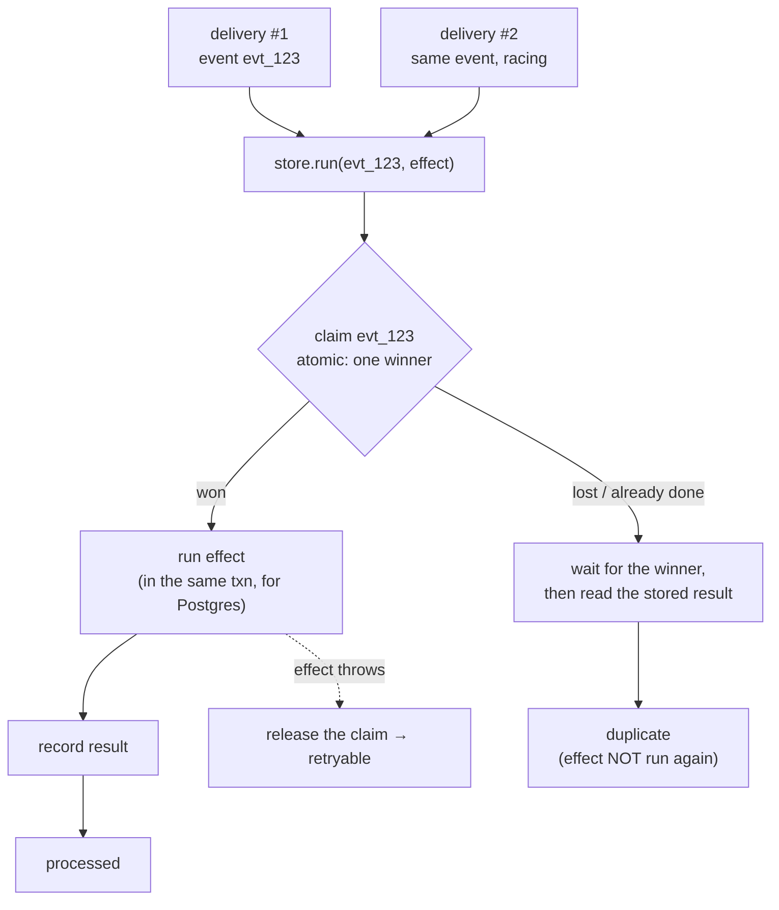

# Design notes

Why this library is shaped the way it is, what it guarantees precisely, and —
just as important — what it does **not** do. If you are evaluating it for real
money moving through a webhook, read the limitations section before the rest.

## The guarantee, stated precisely

> Given an **at-least-once** delivery channel, run a side effect **exactly once**
> per key, and make every later delivery observe the first run's result.

"Exactly once" is about *processing*, not *delivery*. A payment provider will
deliver the same event as many times as it takes to get a `2xx`; that is not a
bug to be fixed, it is the contract of every real webhook. What must happen once
is the *effect* — crediting the account, inserting the ledger row, calling the
downstream API. This library moves the once-ness from the network (impossible) to
the storage layer (a solved problem), keyed by the event's own stable id.

Two distinct failure modes have to be closed, and they are not the same bug:

1. **Sequential duplicates.** The event arrives, is processed, and arrives again a
   second later. A naive `SELECT ... then INSERT` handles this.
2. **Concurrent duplicates.** Two copies arrive in the same millisecond, on two
   servers, and both pass a naive "have I seen this?" check before either writes.
   This is the one that actually loses money, and the one a `SELECT-then-INSERT`
   does **not** close. It needs serialisation, not just a check.

## How each store closes both

### Postgres store — the one for production

The guarantee rests on two database primitives, not on application logic:

- **`INSERT ... ON CONFLICT (key) DO NOTHING RETURNING key`** claims the key.
  Exactly one concurrent transaction gets a row back; every other gets zero rows.
  That is the atomic election of "who is the first delivery" — the database, not
  the app, decides, and it decides once.
- **`SELECT ... FOR UPDATE`** is how the losers wait. A transaction that got zero
  rows from the insert reads the row `FOR UPDATE`, which *blocks* until the
  winner's transaction ends. On the winner's `COMMIT` it reads `status = 'done'`
  and returns the stored result. On the winner's `ROLLBACK` (its effect threw)
  the row is gone, and the waiter retries as the new first caller.

The decisive property: **the effect runs inside the same transaction as the
idempotency record.** Your `UPDATE accounts ...` and the `status = 'done'` write
commit together or roll back together. There is no interval where the money moved
but the event was not recorded, or the reverse. That is why the effect is handed
the transaction's client as its context — so its writes join the same atom.

### Redis store — across processes, when the effect is idempotent

The claim is a single atomic `SET key value NX PX` — only the first caller sets the
key; everyone else gets "already set" and polls the key until it holds the result.
If the effect throws, the holder deletes the key so a later delivery retries. The
TTL (`PX`) is doing double duty: it is both the dedup window and the retention
policy, so unlike the Postgres store there is no table to prune — Redis forgets the
key on its own once the window passes.

What it buys over Postgres: no connection held open for the effect's duration, no
retention job, and Redis-speed claims. What it gives up is in the limitations below.

### Memory store — for one process

No database, so the serialisation is a per-key promise. The first caller for a key
installs a `pending` entry holding a promise that only it can resolve. Concurrent
callers find that entry, `await` the promise, and re-check — so they queue behind
the first run instead of racing it. The claim is synchronous up to the first
`await effect()`, which is what makes it safe: no other call can interleave
between "is there an entry?" and "install my entry" because that window contains
no `await`.

It is correct **only within one process**. It shares nothing across replicas and
survives nothing across a restart. Use it for tests, a CLI, or a single
unreplicated server — never as the dedup layer for a horizontally-scaled service.

## Handler-failure semantics

If the effect throws, **nothing is persisted for the key** and the error is
re-thrown. The next delivery is treated as the first caller and retries. This is
deliberate: a failed credit should be retried by the provider's next delivery, not
silently marked done.

The important corollary, and a real sharp edge:

- **Postgres:** the effect's partial writes are inside the transaction, so a throw
  rolls *them* back too. Retrying is clean.
- **Memory / non-transactional effects:** there is no transaction. If your effect
  does external I/O (charges a card, calls an API) and *then* throws, that I/O is
  not rolled back, and the retry repeats it. The library can only guarantee
  once-ness for work that commits atomically with the idempotency record. For the
  memory store, that means in-process state; for anything crossing a process
  boundary, make the effect itself idempotent or use the Postgres store with the
  I/O expressed as a database write.

## Ordering and other non-goals

- **No ordering guarantee across keys.** Different events run concurrently. If
  event B must not be processed before event A, this library is not where that
  ordering belongs.
- **Not a queue, scheduler, or retry engine.** It makes *your* handler safe to
  call more than once; your framework still receives, acks, and (on a thrown
  error) returns non-2xx so the provider retries.
- **Not a signature verifier.** Verify the provider's signature *before* calling
  `run` — pair it with a signature check (see
  [webhook-signatures](https://github.com/joshuavivo/webhook-signatures)).

## Known limitations

These are the things a reviewer should know going in. None are hidden.

1. **The Postgres table grows forever without pruning.** Every processed key is a
   row kept for dedup. Run `pruneExpiredKeys(pool, { olderThanSeconds })` on a
   schedule (or the one-line `DELETE ... WHERE completed_at < now() - interval`) to
   drop keys older than your provider's retry window. The library ships the helper
   but not a policy — the window is yours to choose, and pruning too early stops
   deduplicating a still-possible redelivery. (The Redis store needs none of this:
   its TTL expires keys itself.)
2. **The memory store is unbounded unless you pass `maxEntries`.** With it, the
   store only dedups within its window: an evicted key, re-delivered, runs again.
   Size the window above the number of distinct events inside the retry window.
3. **The Redis store is not transactional with your effect.** Postgres runs the
   effect and the "done" record in one transaction, so they commit together or not
   at all. Redis has no such transaction here: the effect runs, *then* the result
   is written. If the process dies in between, the key is left `pending` and the
   next delivery (after the pending TTL) retries — so the Redis store is for
   effects that are themselves idempotent, or where the dedup window is the whole
   requirement. For an effect that must be atomic with a database write, use the
   Postgres store. Its dedup is also windowed by the TTL, like the bounded memory
   store.
4. **Stored results must be JSON-serialisable** (Postgres round-trips `result`
   through JSON). Return plain data, not class instances or functions.
5. **A slow effect holds a row lock and a pooled connection for its whole
   duration** in the Postgres store, because the effect runs inside the
   transaction. Keep effects short; do slow, non-transactional work after `run`
   returns, keyed by the result it hands back.
6. **A holder that keeps rolling back is bounded, then errors.** When a holder's
   effect throws, its claim is released and the next caller retries. This is a
   bounded loop (`MAX_CLAIM_ATTEMPTS`, 50), not unbounded recursion: a key whose
   effect fails deterministically raises a clear error after the cap rather than
   retrying forever. Under healthy contention one delivery wins immediately and the
   cap is never approached.

## Testing

Both stores are held to one shared behavioural contract in
[`test/contract.ts`](test/contract.ts): process-once, dedup across repeat
deliveries, the concurrent double-credit race, independent keys, and retry after a
thrown effect. The memory store runs it on every push with no services. The
Postgres store runs the *same* contract when `DATABASE_URL` is set, against a real
database, with per-run key salting so a durable table does not collide across
runs. "Any store that honours the contract is valid" is therefore executable, not
a slogan.
